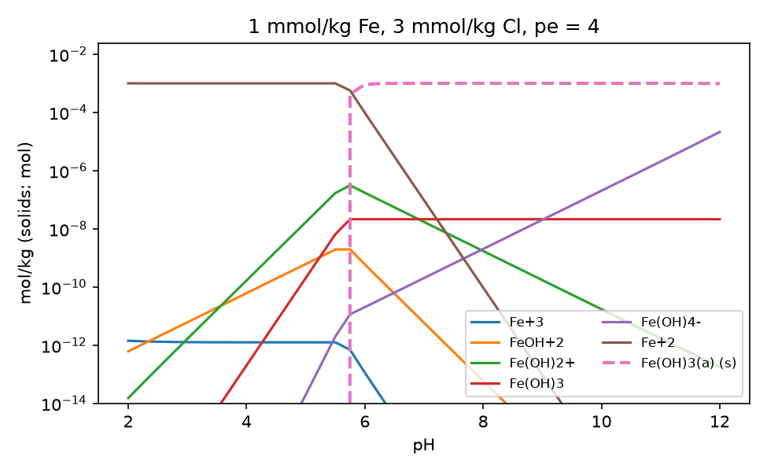
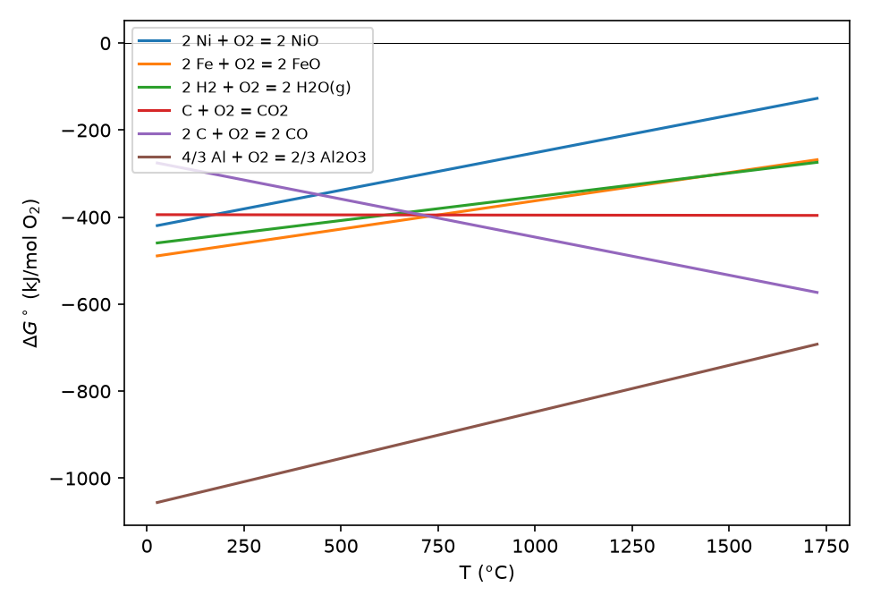

# Diagrams

`discopt.speciation.plot` builds diagrams from full equilibrium calculations, so
aqueous speciation, solid fields and gas phases are mutually consistent. It
needs matplotlib (`pip install discopt-speciation[plot]`).

Every figure on this page was made by
[`docs/figures/make_figures.py`](https://github.com/jkitchin/discopt-speciation/blob/main/docs/figures/make_figures.py)
with the code shown, using the bundled
[`phreeqc.dat`](https://github.com/jkitchin/discopt-speciation/blob/main/src/discopt/speciation/data/phreeqc.dat)
([Parkhurst and Appelo 2013](references.md#parkhurst2013)). The
[diagrams notebook](examples/05-diagrams.ipynb) walks through the same
examples in more detail.

## Sweeps

```python
import numpy as np
import matplotlib.pyplot as plt
from discopt.speciation import PhreeqcDatabase, plot

db = PhreeqcDatabase.load("phreeqc.dat")
s = db.system(["Fe", "Cl"], phases=["Fe(OH)3(a)"])
sw = plot.sweep(s, "pH", np.linspace(2, 12, 41), amounts={"Fe": 1e-3, "Cl": 3e-3}, pe=4)

fig, ax = plt.subplots(figsize=(6.5, 4))
plot.plot_sweep(sw, ["Fe+3", "FeOH+2", "Fe(OH)2+", "Fe(OH)3", "Fe(OH)4-", "Fe+2"], ax=ax, floor=1e-14)
sw.get("SI:Fe(OH)3(a)")        # any quantity along the sweep
```



At pe 4, dissolved iron is almost all Fe²⁺ up to pH 5.5. Between pH 5.5 and
5.75 amorphous Fe(OH)₃ starts to precipitate (dashed), and by pH 6.5 it holds
more than 99.6% of the iron. Each point is a full
equilibrium, so the kinks where the solid appears come out of the
complementarity conditions; they are not drawn in by hand.

**Sweep variables.** The swept variable can be:

- `"pH"`, `"pe"`, `"T"` or `"P"`;
- an input-amount key (`"Cl"`, `"Calcite"`), which gives a titration;
- `"fixed:CO2(g)"`, a fixed log activity or partial pressure;
- a function `value -> dict of equilibrate keywords`, for anything else, e.g.
  changing two amounts together.

## Solubility curves

Sweep a variable and plot a total with `sw.get(fit.total(...))`, or a solid
amount with `"solids:Gypsum"`. Here gypsum is heated in water with anhydrite
allowed as a second phase:

```python
from discopt.speciation import fit

cs = db.system(["Ca", "S(6)"], phases=["Gypsum", "Anhydrite"])
T = np.linspace(0, 100, 26) + 273.15
swT = plot.sweep(cs, "T", T, amounts={"Gypsum": 0.5})
dissolved_ca = fit.total("Ca+2", "CaSO4", "CaHSO4+")

fig, (a1, a2) = plt.subplots(1, 2, figsize=(9, 3.6))
a1.plot(T - 273.15, swT.get("solids:Gypsum"), label="Gypsum")
a1.plot(T - 273.15, swT.get("solids:Anhydrite"), label="Anhydrite")
a2.plot(T - 273.15, swT.get(dissolved_ca) * 1e3, "k")
```


With the `phreeqc.dat` data, gypsum is stable up to between 52 and 56 °C (the
grid spacing) and anhydrite above. Solubility follows whichever solid is
stable, so the curve has a kink at the transition. No phase is selected by
hand.

## Predominance and Pourbaix diagrams

```python
cands = ["Fe+2", "Fe+3", "FeOH+", "FeOH+2", "Fe(OH)2+", "Fe(OH)3", "Fe(OH)4-", "Fe(OH)3(a)"]
cands = [n for n in cands if n in s]          # keep the names this system has

fig, ax = plt.subplots(figsize=(6, 4.8))
pr, _ = plot.pourbaix(s, cands, pH=np.linspace(1, 13, 41), pe=np.linspace(-12, 20, 41),
                      amounts={"Fe": 1e-3, "Cl": 3e-3}, ax=ax)
```


The 41 × 41 grid is 1681 equilibrium solves, about 2.5 minutes; all converged.

**Classifying each point.** At each grid point the candidate with the largest
amount is shown: molality for aqueous species, moles for solids. Pass a dict
of atom counts (`{"Fe2(OH)2+4": 2, ...}`) so species are compared per atom of
the element of interest.

**Diagram features.**

- Dashed lines are the water stability limits at 1 atm.
- `eh=False` plots `pe` instead of Eh.
- `pourbaix` wraps `predominance(system, candidates, x=(var, values),
  y=(var, values), **conditions)`, which works for any pair of variables, such
  as log activity–log activity or T–pH.

**Cost.** Each grid point is one equilibrium solve, typically 5–100 ms, so
start with a coarse grid.

**How this differs from classical Pourbaix diagrams.** Classical diagrams
([Pourbaix 1974](references.md#pourbaix1974)) draw lines where two species
have equal activity, for a chosen total concentration. These diagrams are
computed for the stated total amounts, with activity corrections and all
complexes. Boundaries move with the total concentration, which is the
physically meaningful behaviour.

## Ellingham diagrams

An Ellingham diagram ([Ellingham 1944](references.md#ellingham1944)) plots
the standard Gibbs energy of oxide formation against temperature, per mole of
O₂.

```python
R = 8.314462618e-3  # kJ/(mol K)

def from_linear(A, B):
    """log10 K(T) for dG = A + B*T in kJ per mol O2."""
    return lambda T: -(A + B * T) / (R * T * np.log(10))

oxides = {
    "2 Ni + O2 = 2 NiO": from_linear(-471.0, 0.172),
    "2 Fe + O2 = 2 FeO": from_linear(-528.0, 0.130),
    "2 H2 + O2 = 2 H2O(g)": from_linear(-492.0, 0.109),
    "C + O2 = CO2": from_linear(-394.0, -0.001),
    "2 C + O2 = 2 CO": from_linear(-223.0, -0.175),
    "4/3 Al + O2 = 2/3 Al2O3": from_linear(-1120.0, 0.214),
}
fig, ax = plt.subplots(figsize=(6.5, 4.5))
plot.ellingham(oxides, np.linspace(300, 2000, 60), per={k: 1 for k in oxides}, ax=ax)
```



The coefficients are rounded linear fits of tabulated data, for illustration
only. Lower lines are more stable oxides. The falling 2C + O₂ = 2CO line
crosses FeO near 730 °C; above that, carbon reduces FeO to iron.

**What is plotted.** Each line is $\Delta G^\circ(T) = -RT\ln 10\,\log K(T)$,
in kJ per mol O₂ with `per`.

**Inputs.** Reactions can be `Reaction` objects, e.g. from a `System` with
`analytic` or `dH`/`dCp` data, or plain functions `T -> log10 K`, e.g. from
tabulated $\Delta_f G^\circ$.

**Limitation.** Phase changes of metals and oxides, such as melting, appear
only if your $\log K(T)$ data include them.
