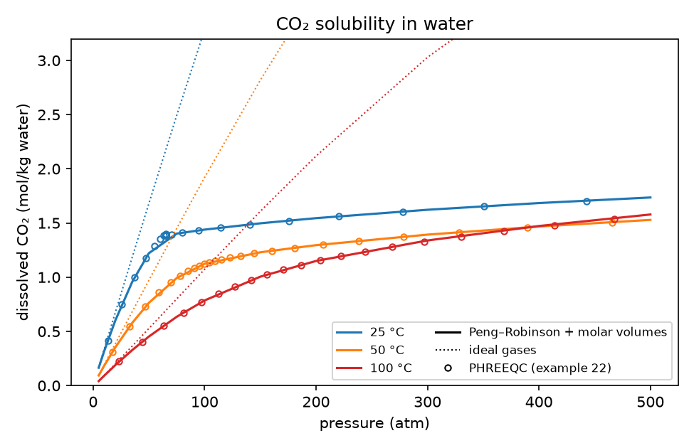

# Gases and pressure

Two effects matter for gas–water systems above a few atmospheres. Gases stop
being ideal, and every equilibrium constant changes with pressure. Both follow
PHREEQC's conventions, so results agree with PHREEQC 3 to the digits in
[Validation](validation.md).



Dissolved CO₂ in pure water under a CO₂ + H₂O(g) gas phase. The solid lines use
Peng–Robinson gases and pressure-dependent $\log K$, the dotted lines ideal
gases, and the circles are PHREEQC's example 22. Above about 50 atm an ideal gas
overestimates the solubility several-fold. The 25 °C curve flattens near
65 atm, where CO₂ condenses.

```python
import numpy as np
from discopt.speciation import PhreeqcDatabase, fit

db = PhreeqcDatabase.load("phreeqc.dat")
dissolved_c = fit.total("CO2", "HCO3-", "CO3-2", "(CO2)2", weights=[1, 1, 1, 2])
for p in (10.0, 100.0, 300.0):
    s = db.system(["C(4)"], gas_phase={"members": ["CO2(g)", "H2O(g)"], "pressure": p})
    r = s.equilibrate({"CO2(g)": 50.0}, T=323.15)          # excess CO2; P is the gas phase's
    print(p, r.pressure, round(dissolved_c(r), 4), r.fugacity_coefficient["CO2(g)"])
```

The full script for the figure is in
[`docs/figures/make_figures.py`](https://github.com/jkitchin/discopt-speciation/blob/main/docs/figures/make_figures.py).

## Non-ideal gases

A gas's activity is its fugacity $f_j = \varphi_j x_j P$, and its saturation
index is $\log_{10} f_j$. Gases with critical constants follow the
[Peng–Robinson](references.md#peng1976) equation of state, with PHREEQC's
constants, mixing rule and default binary parameters
([Søreide and Whitson 1992](references.md#soreide1992)).

| situation | what is solved |
|---|---|
| gas phase at fixed pressure | composition, molar volume (the vapor root) and whether it is present |
| gas phase at fixed volume | the amounts, from $f_j(n, V) = 10^{\mathrm{SI}_j}$; the pressure follows |
| `fixed={"CO2(g)": log P}` | the fugacity $\varphi(T, P)\,P$ of the pure gas, as PHREEQC's `EQUILIBRIUM_PHASES` |

**Constants.** The database gases take $T_c$, $P_c$ and $\omega$ from `-T_c`,
`-P_c` and `-Omega` in phreeqc.dat, pitzer.dat and wateq4f_PWN.dat. Give your
own with `s.gas("Ar(g)", Tc=150.8, Pc=48.0, omega=0.0)` or
`s.critical_constants(...)`, and binary parameters with `kij=` on the gas phase
or `GAS_BINARY_PARAMETERS` in a database file. See
[custom data](custom-data.md#gases-with-critical-constants).

**Results.** `r.partial_pressure` is $x_j P$, `r.fugacity_coefficient` is
$\varphi_j$, and `r.gas_phases[name]` has the pressure, volume, molar volume and
composition.

**Turning it off.** `System(gas_eos="ideal")`, `db.system(..., gas_eos="ideal")`
or `eos="ideal"` on one gas phase.

## Pressure-dependent log K

Above 1 atm each $\log K$ changes with the volume change of its reaction,
$\Delta V_r = \sum_i \nu_{ri} V_i(T, P, I)$, built from the species molar volumes
(PHREEQC's `-Vm`; [Appelo, Parkhurst and Post 2014](references.md#appelo2014)):

$$\log K(T, P) = \log K(T) - \frac{\Delta V_r\,(P - 1\ \mathrm{atm})}{RT\ln 10}.$$

The ionic volumes depend on the ionic strength, so above 1 atm $\log K$ does too,
and it is solved together with the rest of the state. Water's density,
compressibility and dielectric constant follow the pressure, so do the
Debye–Hückel $A$ and $B$, and the Pitzer model lowers its $b$ for ions with
$|z| = 1, 2$, as PHREEQC does. llnl.dat has no molar volumes, so its constants
do not depend on pressure. Details are in [Concepts](concepts.md#pressure).

```python
s = db.system(["Ca", "C(4)"], phases=["Calcite"])
for p in (1.0, 100.0, 500.0):
    r = s.equilibrate({"Calcite": 1.0}, P=p)
    print(p, r.molality["Ca+2"])          # calcite dissolves more under pressure (dV < 0)
```

## Which pressure

`equilibrate(P=...)` sets the pressure. Without it the pressure is, as in PHREEQC:

1. the pressure of a fixed-pressure gas phase;
2. else the computed pressure of a fixed-volume gas phase (found together with the equilibrium);
3. else the largest fixed partial pressure of a Peng–Robinson gas;
4. else 1 atm.

It is never below the vapor pressure of the solution, $p_{sat}(T)\,a_w$, which
matters above 100 °C. `r.pressure` reports the value used. Sensitivities include
the pressure when it follows the state.

## Limits

- **Condensation.** A gas that condenses (CO₂ below 31 °C above ~65 atm) is not
  a separate liquid phase. A fixed-volume gas follows the vapor side from the
  ideal gas and can become dense and liquid-like, as in PHREEQC. Inside the
  liquid–vapor loop PHREEQC caps the pressure and the package does not, so they
  differ there by up to 4e-3 in pH ([Validation](validation.md)).
- **Methods.** `method="gibbs"` and `optimize` do not support Peng–Robinson gases;
  `gibbs` and the global optimizer need $\log K$ independent of the ionic
  strength, so they refuse calculations above 1 atm that use molar volumes.
- **Range.** PHREEQC's water correlations are fitted to 350 °C and 1000 atm; its
  pressure is capped at 1500 atm.
