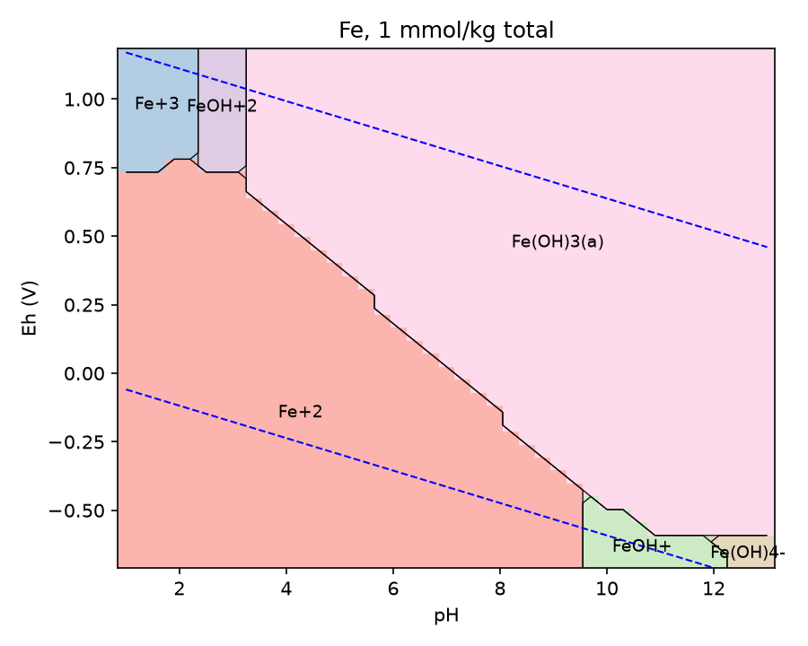
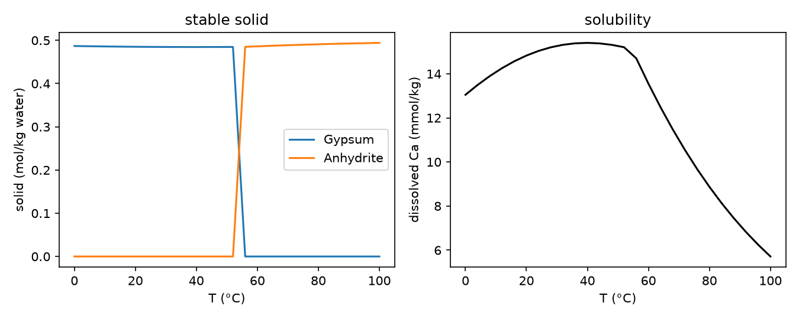

<!-- _paginate: false -->
<!-- _class: lead -->


# Chemical equilibrium you can trust

### discopt-speciation: aqueous speciation as an optimization plugin

**John Kitchin**
Department of Chemical Engineering, Carnegie Mellon University

---

## Outline

1. The problem: which phases are present?
2. Formulation: complementarity, not least squares
3. Solving it: homotopy, active sets, three methods
4. Global stability certificates
5. Validation against PHREEQC
6. Beyond forward solves: sensitivities, fitting, design
7. Using it: Python, YAML, web app, Claude skill

---

## The problem

Given water, dissolved elements, candidate minerals and gases:

- Which species form, and how much?
- Which solids precipitate, which stay dissolved?
- How does that change with T, pH, pe, dose?

<div class="takeaway">

The hard part is the **phase assemblage**: a discrete choice hidden inside a continuous equilibrium problem.

</div>

---

## The equilibrium conditions

| condition | equation |
|---|---|
| mass action | $\sum_i \nu_{ri}\log_{10} a_i = \log_{10} K_r(T,P)$ |
| conservation | $A\,n = b$, rows of $A$ span the left null space of $\nu$ |
| complementarity | $N_p \ge 0,\quad \mathrm{SI}_p \le 0,\quad N_p\,\mathrm{SI}_p = 0$ |
| activity | $a_i = \gamma_i(m,T)\,m_i$ |

Conservation laws are **computed** from the network: element, charge and site balances come for free.

---

## Why complementarity?

Common shortcuts: assume every candidate solid is present, or minimize $\sum \mathrm{SI}^2$.

Their answers change when you:

- multiply a reaction by two
- add an inert polymorph
- list a phase that should have precipitated

<div class="takeaway">

Complementarity = the KKT conditions of Gibbs energy minimization. The answer cannot depend on how reactions are written.

</div>

---

## Invariance, demonstrated

Counterexamples from Laliwala, Amusat and Torres (2025):

| case | change | $\sum\mathrm{SI}^2$ objective | discopt-speciation |
|---|---|---|---|
| CE2 | baseline | 1.05 | NL(s) = 9.537 mmol |
| CE3 | add inert MX′(s) | 17.24 | identical state |
| CE4 | double MX(s) reaction | 4.19 | identical state |

Relative change in the aqueous state across CE2/3/4: **exactly 0**.

---

## Solving: three methods, one answer

<div class="cols">
<div>

**`complementarity`** (default)
1. speciate with no phases
2. smoothed Fischer–Burmeister homotopy
3. active-set polish

</div>
<div>

**`gibbs`**: minimize $G$ directly

**`enumerate`**: solve every assemblage (≤ 12 phases), proves uniqueness

</div>
</div>

<div class="takeaway">

On the Torres cases all three agree: molalities to 2e-10, solids to 3e-11 relative.

</div>

---

## When local is not enough

A **non-ideal solid solution** makes $G$ non-convex.

Inside a miscibility gap, one homogeneous solid satisfies every local condition, but two solids have lower $G$.

Tangent plane distance of a phase at composition $x$:

$$D(x) = \sum_j x_j\left(\ln x_j - \ln 10\,\mathrm{SI}_j\right) + \frac{G_{ex}(x)}{RT}$$

$D(x) \ge 0$ for every phase and every $x$ $\Rightarrow$ global minimum.

---

## A stability certificate

- Pure and ideal phases: exact, $\min D = \ln 10\; s$
- Non-ideal solid solutions: **interval branch and bound** over the simplex
- Unstable? Add a phase copy at the minimizer, split by lever rule, re-solve

```text
stability: certified (tol 1e-06; 1 phase-splitting rounds)
  SS  present  min D in [-4.5e-07, -1.7e-16]  stable
```

PHREEQC ex10 aragonite–strontianite gap: both binodal compositions reproduced to **six digits**.

---

## Physics included

<div class="cols">
<div>

**Activity models**
- ideal, Davies, Debye–Hückel
- Truesdell-Jones, B-dot, LLNL B-dot
- SIT, Pitzer (E-θ, MacInnes)

**Temperature**: van 't Hoff with ΔH, ΔCp, ΔV, or PHREEQC analytic

</div>
<div>

**Phases and interfaces**
- pure solids, solid solutions
- gases at fixed P or V, ideal or Peng–Robinson
- Gaines–Thomas ion exchange
- diffuse double layer surfaces

**Databases**: phreeqc, pitzer, wateq4f, llnl, sit (ThermoChimie)

</div>
</div>

---

## Quick start

```python
from discopt.speciation import PhreeqcDatabase

db = PhreeqcDatabase.load("phreeqc.dat")
s = db.system(["Ca", "C(4)"], phases=["Calcite", "Aragonite", "CO2(g)"])
r = s.equilibrate({"Calcite": 1.0}, fixed={"CO2(g)": -3.5})
print(r.present, round(r.pH, 3))        # ['Calcite'] 8.279
```

Aragonite is listed, but correctly absent: it is metastable.
Want it anyway? `equilibrate(..., suppress=["Calcite"])`.

---

## Or declare your own chemistry

```python
from discopt.speciation import System

s = System("gypsum", activity="davies")
Ca, SO4, CaSO4 = s.aqueous("Ca+2"), s.aqueous("SO4-2"), s.aqueous("CaSO4")
s.reaction(Ca + SO4 >> CaSO4, logK=2.30, dH=5500.0)
s.reaction(s.solid("Gypsum") >> Ca + SO4, logK=-4.58, dH=-460.0,
           name="Gypsum")
print(s.equilibrate({"Gypsum": 1.0}, T=313.15).summary())
```

Also: strict YAML/JSON specs, and overrides on top of a database.

---

## Validation against PHREEQC 3

<div style="font-size: 19px;">

| case | model | agreement |
|---|---|---|
| NaCl + Ca, SO₄, 25/60 °C | Truesdell-Jones | log γ ≤ 6e-6 |
| NaCl 1–4 m + Ca, SO₄ | Pitzer | log a ≤ 5e-5 |
| Th + CO₂, 25–150 °C | LLNL B-dot / SIT | log a ≤ 1.8e-4 |
| Calcite + CO₂(g) | phreeqc.dat | pH 1e-7 |
| Zn on Hfo, DDL | phreeqc.dat | ψ ≤ 1.4e-4 rel |

</div>

227 steps of the PHREEQC example problems, each a test. Known limits are `xfail(strict=True)` with a diagnosis.

---

## Honest about the limits

- **Log-molality floor** (−200): vanishing redox states can stall
- **No pressure term in log K**: matters above ~10 atm (issue #2)
- **Gas condensation**: one vapor phase, largest Peng–Robinson root
- **Water gfw**: 18.016 vs 18.01528, a convention

<div class="takeaway">

Every result carries independent `residuals`. `converged` means all are below 1e-8.

</div>

---

## Diagrams from full equilibria

<div class="cols">
<div>



</div>
<div>

- Sweeps, predominance, Pourbaix, Ellingham
- Every point is a full equilibrium
- Phase boundaries emerge from complementarity, not hand drawing

</div>
</div>

---

## Gypsum to anhydrite, for free



The phase transition near 55 °C and the solubility kink come straight out of the T sweep.

---

## Exact sensitivities

At a converged state the assemblage equations are square: $F(x,\theta)=0$.

$$\frac{dx}{d\theta} = -F_x^{-1}F_\theta$$

- $F_x$ exact via JAX forward mode
- No extra solves
- Phases on a kink ($N_p = 0$, $\mathrm{SI}_p = 0$): one-sided derivatives, reported as such

---

## Fitting constants to data

Calcite at 8 CO₂ pressures; measure pH and dissolved Ca (synthetic, noise added).

```text
chi2 = 15.07, dof = 14, reduced chi2 = 1.077
parameter            value    std err   95% CI
logK Calcite       -8.4711    0.0095   [-8.4897, -8.4525]
logK CaHCO3+        11.471      0.15   [11.178, 11.764]
```

True values −8.480 and 11.435: both inside the intervals. Profile likelihood available too.

---

## Design and worst-case bounds

Equilibrium becomes a constraint inside a discopt model.

```python
r = O.design(s, {"Al": 1e-3, "Cl": 3e-3}, {"NaOH": (0, 6e-3)},
             objective="NaOH",
             constraints=[(O.dissolved("Al"), "<=", 1e-6)],
             reagents={"NaOH": {"Na": 1, "OH-": 1}})
# ('local_optimum', {'NaOH': 0.0029818}, True)
```

`worst_case_bounds`: min/max of a quantity over a box of log K uncertainty, via spatial branch and bound. **Certified** only when every bound is rigorous.

---

## Try it in the browser

- Pyodide + the **pounce** NLP solver in WebAssembly
- Same algorithm as the package, nothing on a server
- Speciation, sweeps, Pourbaix, log K(T), exported Python
- The URL holds the setup: share a link, share a calculation

<span class="small">kitchingroup.cheme.cmu.edu/discopt-speciation/app/</span>

---

## Ask in plain language

```bash
discopt-speciation-install-skill
```

- `/discopt-speciation` Claude Code skill
- Five tested example scripts to copy from
- A `speciation-expert` agent for difficult cases

"What dose of NaOH keeps dissolved Al below 1 µM?"

---

## Summary

- Complementarity gives answers independent of how chemistry is written
- Interval certificates prove global stability with solid solutions
- Validated against PHREEQC across 227 example steps
- Sensitivities, fitting with uncertainty, and design come built in
- Python, YAML, browser, or a conversation

---

<!-- _class: lead -->
<!-- _paginate: false -->

# Thank you

github.com/jkitchin/discopt-speciation
kitchingroup.cheme.cmu.edu/discopt-speciation

<div class="small">

Parkhurst & Appelo (2013) PHREEQC 3, doi:10.3133/tm6A43
Laliwala, Amusat & Torres (2025) Syst. Control Trans. 4, 2140, doi:10.69997/sct.132742
Michelsen (1982) Fluid Phase Equilib. 9, 1, doi:10.1016/0378-3812(82)85001-2

</div>
